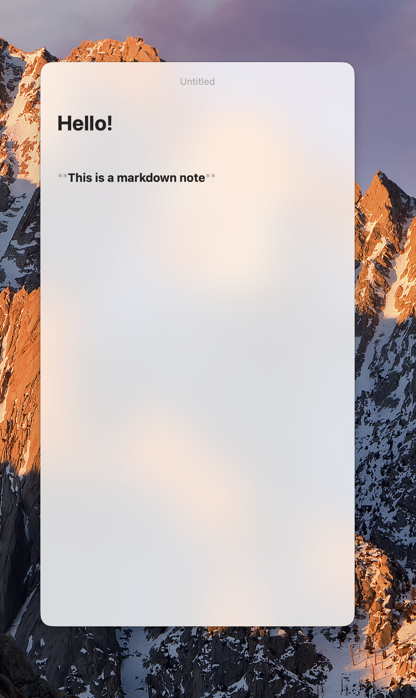

# Portal

A floating Markdown note pane for macOS that reads and writes your Obsidian vault in place.

<p align="center">
  
</p>

## Features

- **Always at hand**: a translucent panel that floats above other apps, toggled from the menu bar or a global shortcut.
- **Your vault, as-is**: notes are plain `.md` files in your Obsidian vault. Changes made in Obsidian are picked up when the panel gains focus.
- **Live Markdown**: inline styling, tasks, wikilinks, image embeds and pasted images, code highlighting, math (KaTeX) and Mermaid diagrams.
- **Daily notes**: open today's note from your Daily Notes template, with unfinished todos rolled over.
- **Keyboard first**: command palette, fuzzy note switcher, in-note find and Vim keybindings.
- **Safe saves**: edits made outside Portal are detected before writing, so nothing gets silently overwritten.

## Shortcuts

| Shortcut | Action |
| --- | --- |
| `⌘K` | Action panel |
| `⌘P` | Browse notes |
| `⌘N` | New note |
| `⌘D` | Daily note |
| `⌘F` / `⌘G` / `⇧⌘G` | Find, next, previous |
| `⌘B` / `⌘I` | Bold / italic |
| `⌘L` | Toggle task |
| `⇧⌘K` | Insert link |

Set a global toggle shortcut by right-clicking the menu bar icon.

## Build

Requires macOS 27 and Xcode with Swift 6.4.

```sh
make app             # builds build/Portal.app
open build/Portal.app
```

Run the tests with `swift test`.
